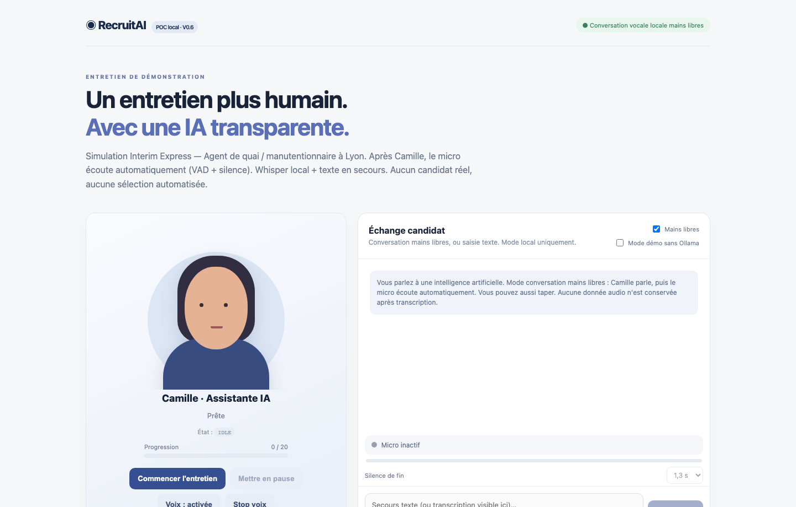
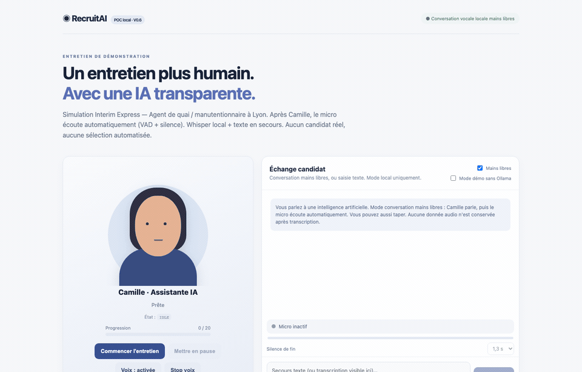
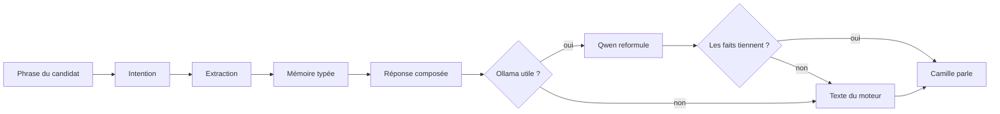
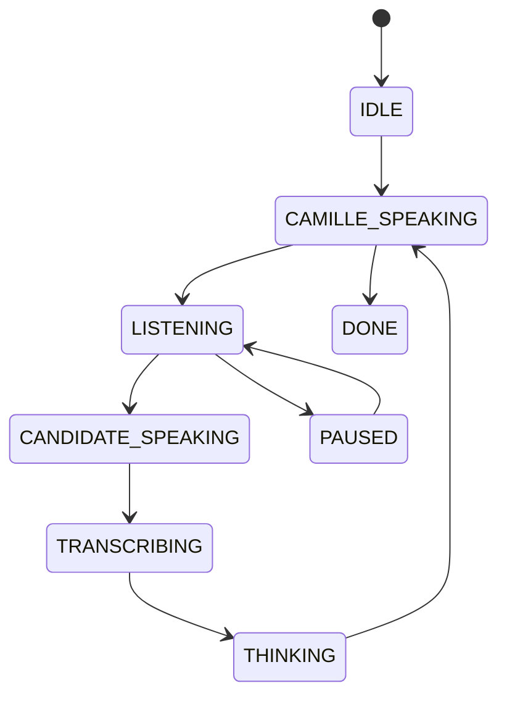
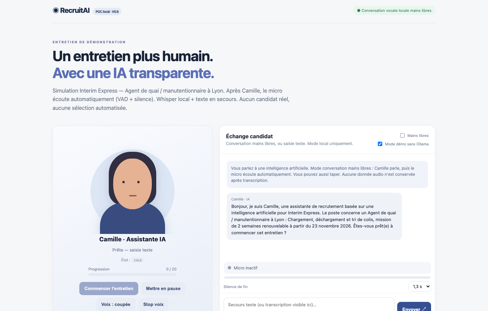
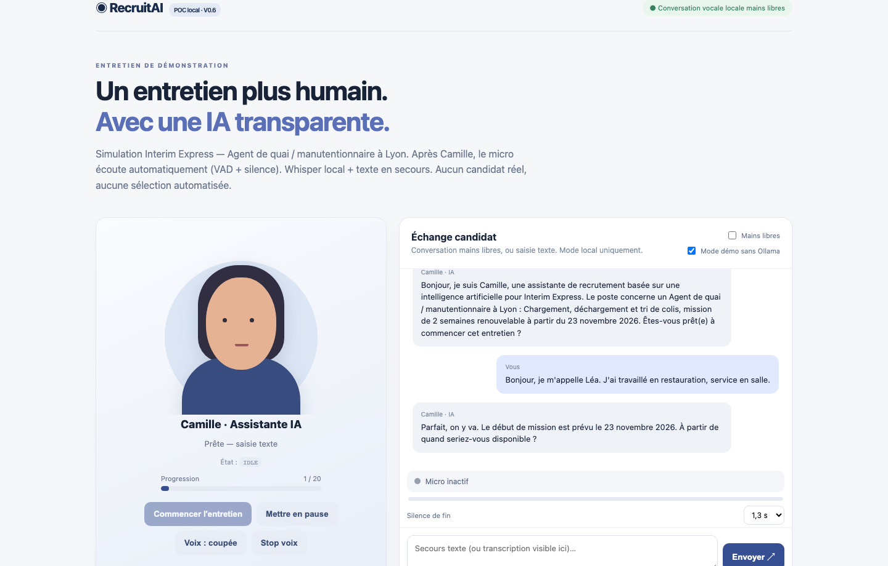
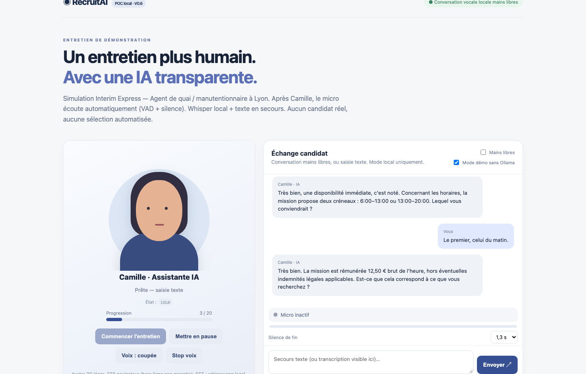
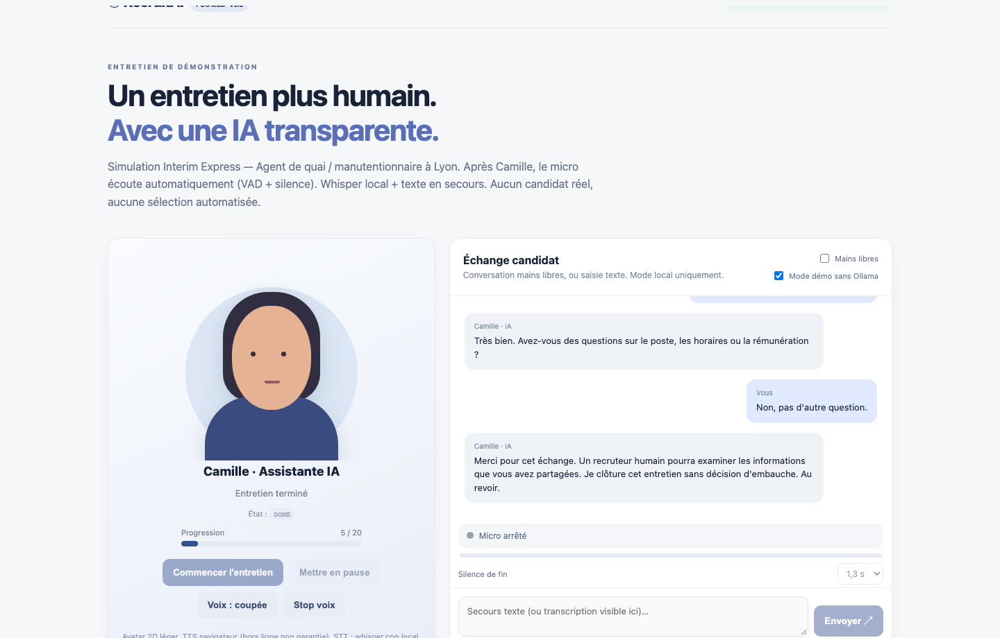
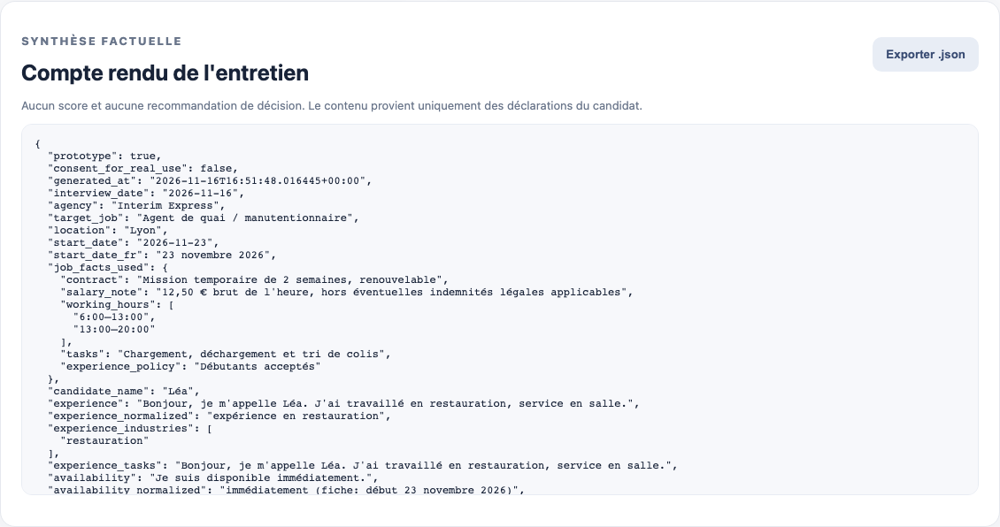

# RecruitAI

Entretien structuré local, en français, pour une agence d’intérim fictive. Camille pose les questions, retient les faits, et rend un compte rendu sans score et sans décision d’embauche.

*Local structured interview POC. French temporary-staffing demo. No candidate scoring. Nothing leaves the machine.*



V0.6 · macOS · Python standard · Ollama · whisper.cpp · poste de démo **Agent de quai / manutentionnaire**, Lyon, Interim Express.

Les captures de ce fichier viennent du **mode démo** (sans Ollama), avec une candidate fictive, Léa, saisie au clavier le 16 novembre 2026. Le micro mains libres existe ; il n’est pas dans le GIF.

## V2 : MVP SaaS en visio (`web/`)

Une version Next.js vit dans [`web/`](web) : site vitrine, comptes agence, postes, liens d’entretien par candidat, comptes rendus. Le candidat passe l’entretien en visio : visage photoréaliste synchronisé sur la voix (LiveAvatar), voix en temps réel (Gemini Live). Sans clé, tout tourne en mode démo.

```bash
cd web && npm install && npm run dev   # http://localhost:3000
```

Le POC Python ci-dessous reste intact. Détails : [web/README.md](web/README.md) et [docs/V2-CLOUD.md](docs/V2-CLOUD.md).

## La minute de démo



1. Camille se présente comme IA et décrit la mission (chargement, déchargement, tri de colis, 12,50 € brut / heure, début le lundi 23 novembre 2026).
2. Léa dit qu’elle a fait de la restauration, en salle. Le moteur range ça en expérience, pas en nom.
3. « Je suis disponible immédiatement » devient une disponibilité normalisée.
4. « Le premier, celui du matin » est lu comme le créneau `6:00–13:00`, pas comme une nouvelle question.
5. Camille ferme sans recommandation. Un recruteur humain lit le JSON.

## Ce que c’est

Un proof of concept volontairement petit. Une agence peut voir comment collecter des déclarations liées au poste, puis relire un rapport factuel. Le modèle ne décide pas. Il reformule, quand il y arrive, une réponse déjà composée par le moteur.

Ça tourne sur un Mac 8 Go. Le serveur n’a aucune dépendance pip. Les entretiens restent en mémoire. L’audio est effacé après transcription.

**Ne jamais y mettre un vrai candidat, un CV, ou un enregistrement réel.**

## Ce que Camille collecte

Même trame à chaque fois. Elle n’avance pas mécaniquement après chaque phrase.

| Étape | Ce qu’elle cherche |
| --- | --- |
| Intro | Se présenter comme IA, expliquer le poste, attendre un « prêt » |
| Expérience | Secteur et tâches. La restauration déclenche une relance, sans inventer de compétence transférable |
| Disponibilité | « maintenant », une date, un décalage avec le début de mission |
| Horaires | `6:00–13:00` ou `13:00–20:00`, y compris « le premier », « celui du matin », « les deux », « aucun » |
| Salaire | Attente du candidat, confrontée au 12,50 € brut affiché |
| Questions | Réponses **uniquement** depuis `data/demo_job.json` |
| Clôture | Remerciement. Pas de oui, pas de non, pas de classement |

Un même message peut contenir un fait et une question. « Dispo à partir du 1er décembre, c’est sur Paris ? » enregistre la date et répond que la mission est à Lyon.

Les intentions reconnues : `ANSWER`, `QUESTION_ABOUT_JOB`, `CLARIFICATION_REQUEST`, `INCOMPLETE_ANSWER`, `OFF_TOPIC`, `END_INTERVIEW`.

« Je suis prêt » n’est jamais un nom. « Je m’appelle Léa » l’est.

## Comment une réponse est produite



Le modèle ne choisit pas la prochaine question et n’invente pas le salaire. S’il sort de l’anglais, un préfixe `Question :`, ou un fait absent de la fiche, le serveur jette la reformulation et garde la phrase du moteur. Ollama est appelé avec `think: false`.

Sous-états temporaires, à côté des étapes : attente d’une question candidat, réponse à cette question, clarification, reprise, confirmation (par exemple une dispo plus tardive que le début de mission).

## La voix



- Le micro s’ouvre tout seul après la voix de Camille. Pas de push-to-talk.
- La détection de parole est un VAD Web Audio. Le silence de fin est réglable (1,0 s à 2,0 s, 1,3 s par défaut).
- Le micro est coupé pendant que Camille parle, plus un court délai, pour éviter l’écho.
- Whisper `tiny`, en local, transcrit en français. ffmpeg convertit l’audio du navigateur en WAV 16 kHz mono.
- La synthèse vocale est celle du navigateur. **Hors ligne non garanti** : selon l’OS, une voix peut passer par un service système.
- Le texte reste disponible à tout moment. Pause et reprise aussi.

## Captures

Intro, mode démo, voix coupée pour la prise.



Expérience en restauration, puis la question de disponibilité. Le compteur passe à 1 / 20.



« Le premier, celui du matin » est compris. Camille enchaîne sur le salaire de la fiche.



Clôture explicite : aucun avis d’embauche.



Le rapport exportable. Brut et normalisé, prototype, pas de note.



## Démarrer

macOS Apple Silicon de préférence. Python 3.10+. Ollama en application officielle, pas via Homebrew sur cette machine. `ffmpeg`, `git`, `cmake`, les Command Line Tools.

```bash
export PATH="/Applications/Ollama.app/Contents/Resources:$PATH"
ollama pull qwen3:1.7b    # défaut, ~1,4 Go
ollama pull qwen3:0.6b    # repli, ~523 Mo

chmod +x scripts/setup_whisper.sh
./scripts/setup_whisper.sh

python3 server.py
# http://127.0.0.1:8765
```

Cocher **Mode démo sans Ollama** pour parcourir l’interface sans modèle. Sur 8 Go serrés :

```bash
OLLAMA_MODEL=qwen3:0.6b python3 server.py
```

Autres variables : `HOST`, `PORT`, `OLLAMA_URL`, `OLLAMA_FALLBACK_MODEL`, `WHISPER_BIN`, `WHISPER_MODEL`, `FFMPEG`.

Le détail d’installation est dans [docs/SETUP.md](docs/SETUP.md).

## Le dépôt

```
server.py              HTTP local, stdlib seulement
interview.py           intention, extraction, mémoire, composition
public/                HTML, CSS, JS, VAD, TTS
data/demo_job.json     la seule source de vérité du poste
docs/                  architecture, setup, scope, bench, captures
scripts/               build whisper, benchmark des modèles
tests/                 serveur, régression, intentions mixtes
tools/whisper.cpp/     clone local, ignoré par git
```

`tools/whisper.cpp/` est produit par `scripts/setup_whisper.sh`. Il ne se commit pas. Les enregistrements, `.wav`, `.mp4` et dumps dans `data/` non plus. Seul `data/demo_job.json` est versionné.

## Tests

```bash
python3 tests/test_server.py
python3 tests/test_conversation_regression.py
python3 tests/test_mixed_intent.py
python3 scripts/benchmark_models.py   # réécrit docs/BENCHMARK.md avec des mesures
```

## Deux modèles, mesurés

Chiffres relevés sur cette machine par `scripts/benchmark_models.py`, pas des estimations. L’extraction (nom, horaires, restauration, disponibilité) est identique pour les deux : elle est dans `interview.py`.

| Modèle | Latence moyenne | P50 | Checklist qualité | RSS échantillon |
| --- | ---: | ---: | ---: | ---: |
| `qwen3:0.6b` | 2,291 s | 3,071 s | 100 % | 2007 Mo |
| `qwen3:1.7b` | 3,637 s | 3,869 s | 96,9 % | 2005 Mo |

Le 0.6B est plus rapide et colle souvent à la phrase du moteur. Le 1.7B paraphrase mieux en français, et peut aussi laisser fuir un raisonnement en anglais : dans ce cas le serveur rejette la phrase. Le défaut reste donc `qwen3:1.7b`, avec repli `qwen3:0.6b`. Le tableau complet et les réponses brutes sont dans [docs/BENCHMARK.md](docs/BENCHMARK.md).

## API

Tout est sur `127.0.0.1:8765`.

| Route | Rôle |
| --- | --- |
| `GET /api/health` | version `0.6`, modèle, repli, whisper, ffmpeg |
| `GET /api/job` | fiche de poste, date de début calculée |
| `POST /api/next` | `{ history, demo }` → réplique, étape, intention, slots |
| `POST /api/transcribe` | audio → WAV → whisper `-l fr` → texte, puis suppression du fichier |
| `POST /api/report` | JSON factuel, sans score |

Audio plafonné à 8 Mo. L’historique JSON est borné. Les fichiers statiques ne sortent pas de `public/`. Les processus externes sont lancés sans shell.

## Sécurité

Prototype. Pas d’auth, pas de HTTPS, pas de journal d’audit, pas de consentement outillé. Le bind par défaut est localhost. Ne pas exposer le serveur, ne pas brancher un ATS, ne pas committer de secret, de CV ou d’audio.

Le poste dans `data/demo_job.json` est fictif. Le rapport le redit.

## Hors sujet, pour l’instant

Avatar photoréaliste, APIs cloud payantes, comptes, base de données, score, classement, inférence de personnalité, rejet automatique, déploiement public. La suite technique envisagée : voix française locale (Piper ou Kokoro, licences à vérifier), VAD plus robuste, avatar 3D plus tard.

Le cadre d’acceptation est dans [docs/POC-SCOPE.md](docs/POC-SCOPE.md). Le découpage technique est dans [docs/ARCHITECTURE.md](docs/ARCHITECTURE.md).

## Licence

[MIT](LICENSE).
